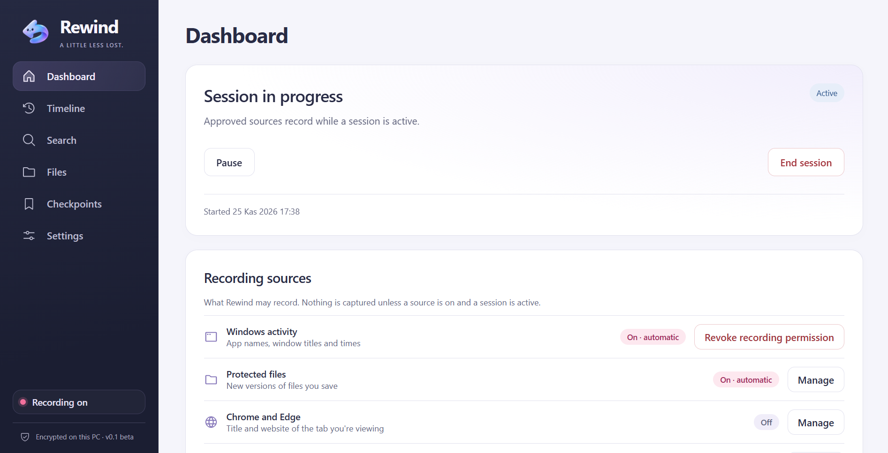

# Rewind — Official Website


### Your digital past. Always within reach.

The official landing page and download website for Rewind, a Windows desktop application designed to help users revisit their digital activity, recover previous file versions, and stay in control of their digital workflow.

---

## About Rewind

Rewind aims to make digital history more accessible, organized, and recoverable.

By bringing activity history, smart search, file recovery, and checkpoints together, Rewind helps users rediscover important moments in their digital workflow.

## Dashboard Preview



## Website Features

- Modern dark-themed user interface
- Responsive desktop and mobile design
- Rewind product introduction
- Desktop application dashboard preview
- Interactive product demo video
- Windows beta download integration
- Step-by-step installation guide
- Direct access to the desktop application repository

## Rewind Desktop Features

- **Activity Timeline:** Explore digital activity and revisit previous sessions.
- **Smart Search:** Find previous activities and quickly return to important information.
- **File Recovery:** Access and recover previous file versions.
- **Checkpoints:** Keep track of important moments.
- **Browser Integration:** Connect your browser and explore browsing activity.
- **Privacy & Control:** Manage recording sessions with start, pause, resume, and end controls.

Some features may still be under development during the beta phase.

## Technologies Used

- React
- TypeScript
- Vite
- CSS
- ESLint
- Git & GitHub

## Getting Started

### Prerequisites

- Node.js
- npm
- Git

### Installation

Clone the repository:

```bash
git clone https://github.com/hacerdilarakivrak/rewind-website.git
```

Navigate to the project directory:

```bash
cd rewind-website
```

Install dependencies:

```bash
npm install
```

Start the development server:

```bash
npm run dev
```

Open the local URL displayed in your terminal.

## Available Scripts

| Command | Description |
| --- | --- |
| npm run dev | Start the development server |
| npm run build | Generate a production build |
| npm run preview | Preview the production build |
| npm run lint | Check code quality with ESLint |

## Project Structure

```text
rewind-website/
├── public/
│   ├── rewind.png
│   ├── dashboard.png
│   └── rewind-demo.mp4
├── src/
│   ├── App.tsx
│   ├── App.css
│   ├── index.css
│   └── main.tsx
├── index.html
├── package.json
├── vite.config.ts
└── README.md
```

## Download Rewind

The website provides access to the Windows beta installer.

- Platform: Windows Desktop
- Release: Beta
- Installer size: Approximately 166 MB

### Security Notice

Rewind is currently in beta, and the Windows installer is not yet digitally signed.

Google Drive and Windows SmartScreen may display security warnings during the download and installation process.

Always verify the installer and trust its source before proceeding with installation.

## Deployment

The website is prepared for deployment on Vercel.

- Framework: Vite
- Build command: npm run build
- Output directory: dist

## Related Repositories

- [Rewind Desktop Application](https://github.com/abdu3061/Rewind)
- [Rewind Website](https://github.com/hacerdilarakivrak/rewind-website)

The website is maintained separately from the main desktop application repository.

## Project Status

- Website development: Completed
- Responsive design: Completed
- Product demo integration: Completed
- Download integration: Completed
- Production build: Completed
- Website deployment: Pending
- Desktop application: Beta

---

**Move forward. Look back whenever you need.**

© 2026 Rewind. All rights reserved.
